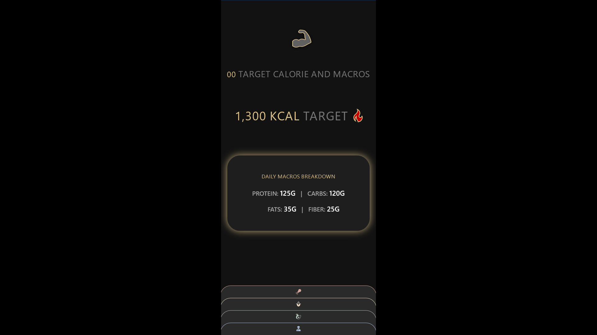
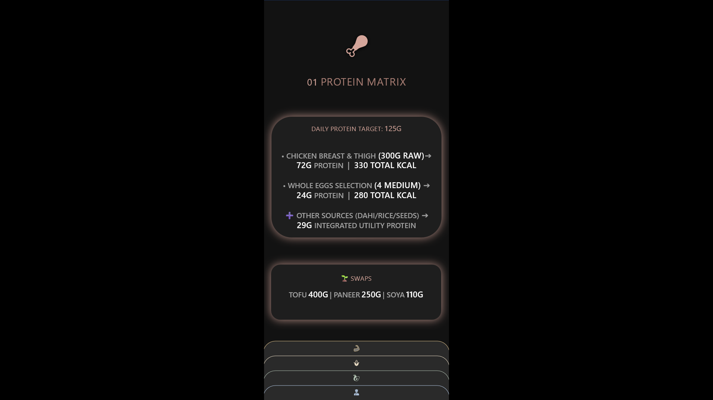
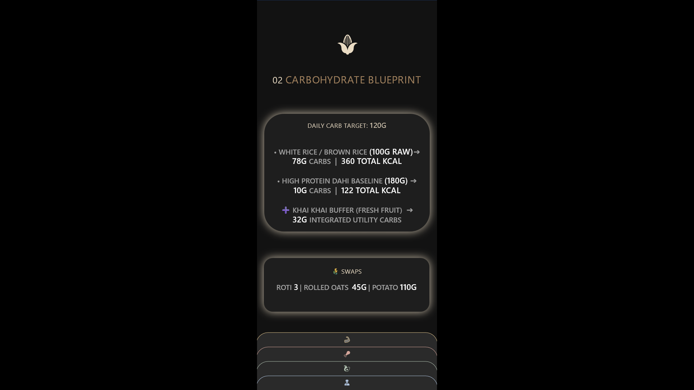
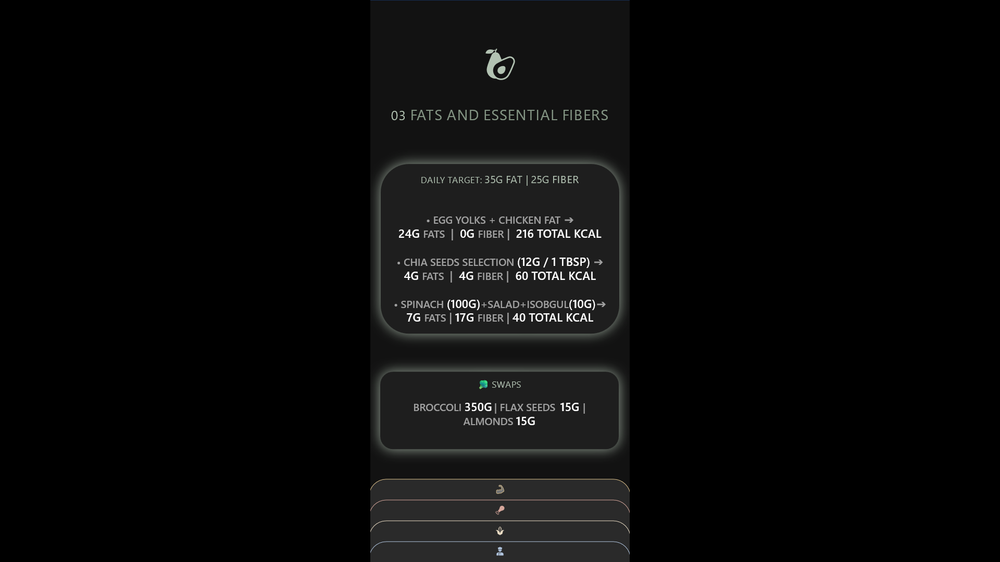
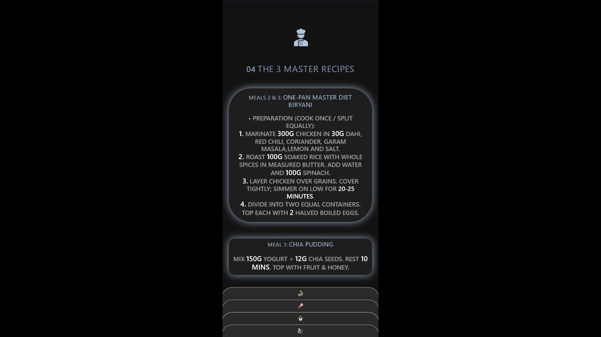
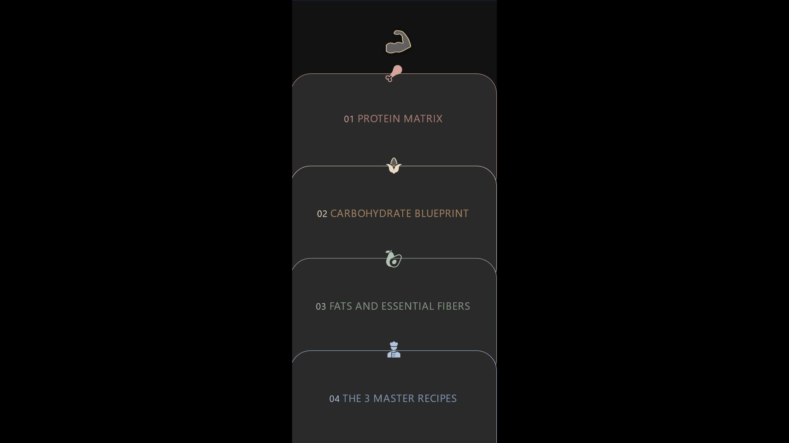
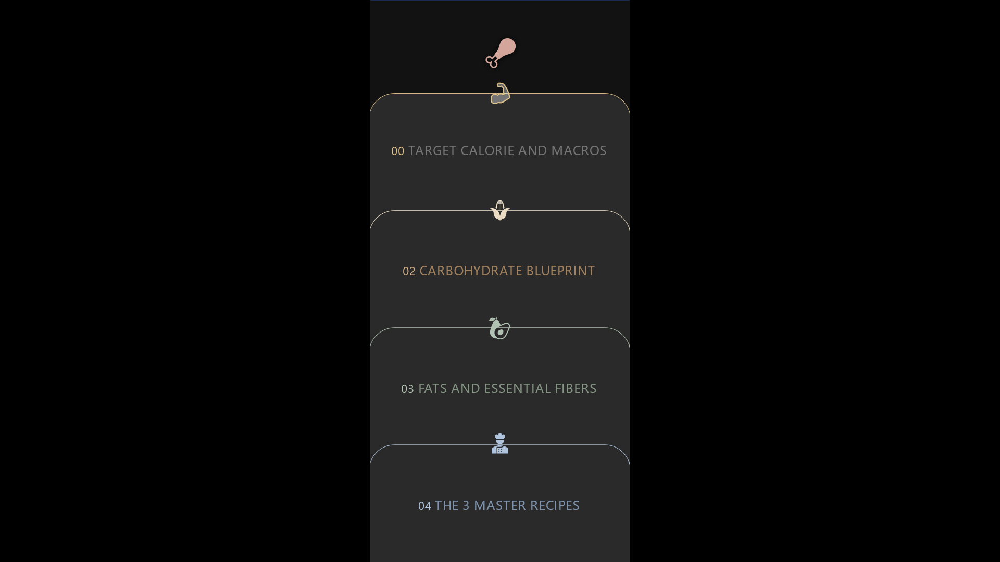
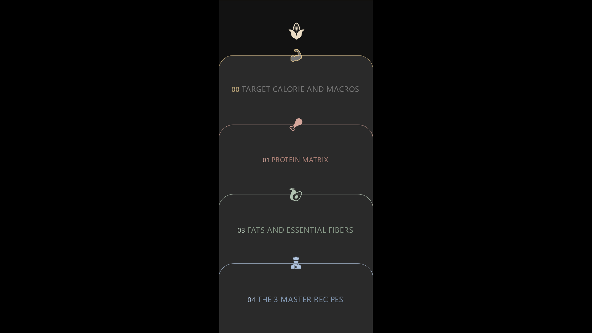
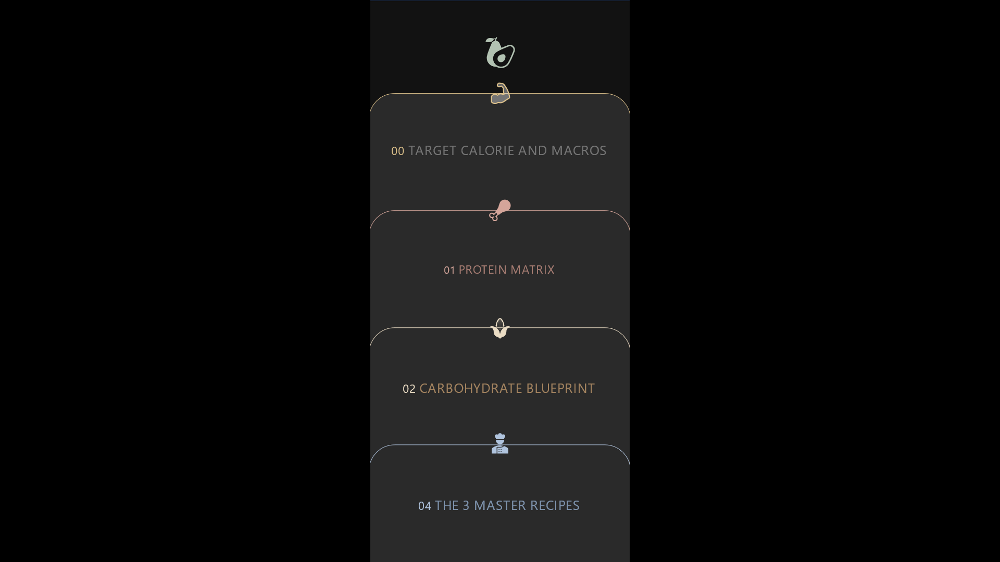
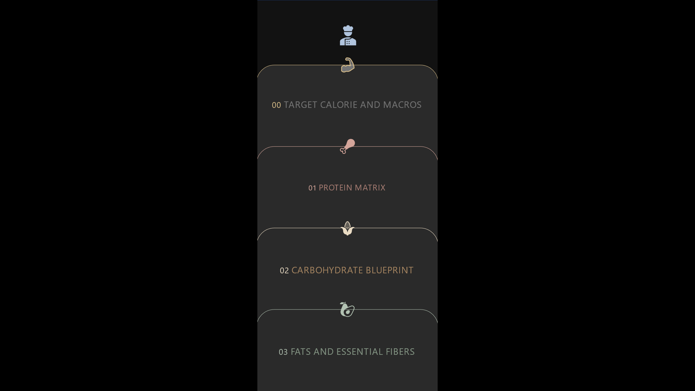

# Interactive Fitness & Nutrition Concept

## Overview

This project started as a way to make fitness and nutrition information easier to understand and use. I created an interactive, app-style experience in PowerPoint, designed around a person's daily calorie and macronutrient targets.

Instead of presenting everything in a long document, I organised the information into separate sections with clickable navigation. The idea was to make it easier to find the right information at the right time, whether checking food portions while shopping or following a recipe while cooking.

The project combines visual design, interactive navigation, and AI-assisted problem-solving to turn a basic idea into a working concept.

## Project Demo

Download and watch the interactive concept in action.

[▶ Watch the Demo Video](Fitness_UIUX_recording.mp4)

## Project Files

- [PowerPoint File](Fitness%20App%20Concept.pptx)

## Why I Created It

I originally prepared fitness and nutrition guidance for a friend who wanted help with their diet. I wrote down the information, including calorie targets, macronutrient requirements, food portions, and meal ideas.

However, my friend found the document boring to read. They wanted something more engaging and easier to navigate, without having to go through everything to find one piece of information.

That made me rethink how I presented the information. The problem wasn't a lack of content. It was how the content was communicated.

I wanted to create something that felt more like using an app than reading a document. The user should be able to open a section, find the information they need, and move on without being overwhelmed by too much information at once.

I also wanted to explore the creative side of problem-solving. I had already spent time learning data analysis and building dashboards. This project gave me an opportunity to explore visual design, interaction, and a different way of communicating information.

## The Concept and Design Approach

I wanted the presentation to feel like a mobile app rather than a traditional slideshow. I had seen a card-based presentation online and liked the idea of using cards to navigate between different sections. I adapted that idea to fit my own concept.

I placed the main information in a central area and arranged the navigation cards at the bottom of each page. When a user clicks these cards, they open a transition screen designed specifically for the page they are viewing. From there, the user can select another section to visit.

Each page has its own transition screen, with matching icons and labels. For example, clicking the cards on the homepage opens the homepage's transition screen, while clicking the cards on the protein page opens a separate transition screen designed for that section. I chose this approach instead of using one generic transition screen to keep the navigation relevant to the current page and avoid showing an option for a section the user is already viewing.

The cards have limited space for text, so I also made the icons clickable. This gives users another way to navigate between sections without adding more labels to the design.

I wanted the overall design to remain consistent. I chose a dark background with warm accent colours to give it a clean, premium look. The main information stays in the same central area across the pages, so users know where to look instead of having to adjust to a different layout each time.

I used AI to brainstorm the visual direction, explore colour combinations, and compare suggestions from different models. I combined the ideas I found useful and made the final design choices myself. My aim was to keep the interface simple, visually engaging, and practical for everyday use.

## Content Structure and Features

I organised the information into separate sections so the user could find what they needed without going through everything at once. The homepage gives an overview of the daily calorie target and macronutrient breakdown. The other pages provide more detail about how to meet those targets through food choices and portion sizes.

### Homepage: Daily Targets

The homepage shows the daily calorie target and the required amounts of protein, carbohydrates, and fats. I wanted users to see the overall picture as soon as they opened the presentation, without having to navigate through several pages first.

### Protein, Carbohydrates, and Fats

I gave each macronutrient its own page because knowing a daily target is not always enough. For example, knowing how much protein to consume does not tell someone how much chicken, fish, or another food they need to eat.

These pages connect the targets to practical food portions and alternatives. I also included options for different food preferences, so users could make substitutions while keeping their portions in line with their targets.

### Master Recipes

I created three master recipes for breakfast, lunch, and dinner. These provide a starting point for planning meals without restricting users to the same dishes every day. The idea was to give them a practical reference while leaving room to experiment with other recipes and ingredients.

### Custom Transition Screens

Each page has its own transition screen, designed to match the section the user is viewing. These screens provide a consistent way to navigate between sections while keeping the current page in context.

## Testing and Problem-Solving

I designed the concept for mobile use because my friend would need it while shopping for ingredients or preparing meals. A phone was more practical for these situations than a desktop or laptop.

After building the initial version, I transferred it to my phone to test the navigation. I found that tapping an empty area could move the presentation to the next slide instead of following the intended navigation. This broke the app-like experience I wanted to create.

I researched ways to prevent these accidental slide changes and used transparent shapes with links to the current slide. I also adjusted the placement and layering of these shapes so they would not interfere with the visible design or the intended links.

I then explored different presentation formats and apps to find a way to preserve the interactive experience on mobile devices. I tested the changes on my own phone before sharing the finished version with my friend.

This process taught me that creating the design is only one part of the work. Testing is just as important because problems may not become visible until the project is used in its intended environment. It also reinforced the value of checking the experience from the user's perspective rather than assuming that everything will work because it looks right on the screen.

## What I Learned

This project taught me that having an idea is only the starting point. I had to turn it into a working design, solve problems along the way, and test the final result.

One of my biggest takeaways was that **understanding the concept matters more than knowing a particular tool**. Before creating something, you need to understand what it is, what purpose it serves, and how it should look and work. For example, creating an infographic or a brochure is not just about knowing how to use a design tool. It starts with understanding how that format communicates information and thinking about how to apply it to a specific purpose.

Once I understood what I wanted to create, I could work out how to build it in PowerPoint, even though I had limited knowledge of the tool. This changed how I think about creative work. Tools can change, and new ones can offer better ways to execute an idea. The ability to understand a concept, visualise a solution, and figure out how to bring it to life is what makes it possible to work across different formats.

I also learned the importance of consistency, attention to detail, and testing. Small differences in layout can affect the overall experience, while problems with navigation only became clear when I tested the presentation on my phone. I had to troubleshoot these issues and check the result from the user's perspective.

AI helped me explore ideas, compare design suggestions, work out measurements, and troubleshoot problems. I combined its guidance with online tutorials and my own experimentation rather than relying on a single source.

Most importantly, I learned that I could take a concept from an initial idea to a working design in about half a day, despite starting with limited knowledge of the tool. I came away with greater confidence in my ability to understand a creative problem, visualise a solution, and learn whatever tools I need to execute it.

## What's Next

This project has opened up several possibilities for me beyond interactive PowerPoint designs.

One direction I want to explore is making this concept more flexible. The current version is designed around one person's nutritional targets. In the future, I would like to learn app development and build a version where users can enter their own details and get numbers adjusted to their targets.

I also want to apply the same approach to other types of creative work. For example, I could create interactive infographics that guide users through a process, brochures that reveal information through clickable sections, or campaign concepts that make complex ideas easier to understand.

The same thinking could also be applied to app and website concepts, where the goal is to organise information and help users find what they need. I want to keep exploring different tools and formats rather than limit myself to one type of design.

For me, this project was a starting point. It showed me how I could take an idea from the initial concept to a finished design, learn the tools needed along the way, and keep improving through testing and feedback.
